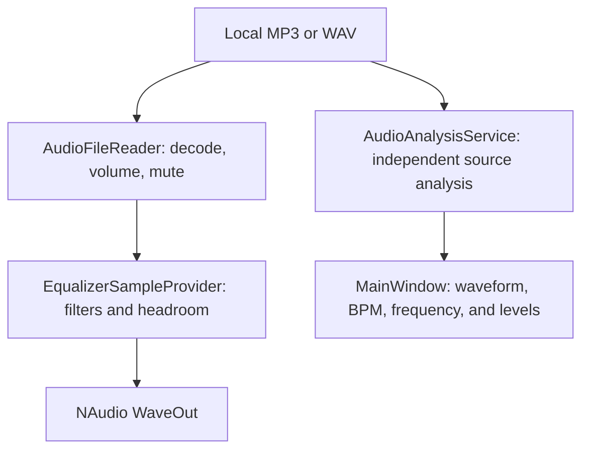

# MusicPlayer

MusicPlayer is a Windows desktop application for playing local MP3 and WAV files. It combines a searchable, folder-based music library with an interactive waveform, playback-synchronized signal analysis, automatic tempo estimation, and a ten-band graphic equalizer.

## Requirements and installation

Use a Windows desktop with the .NET 10 SDK and Git available in PowerShell. The application and test project target `net10.0-windows`. From PowerShell:

```powershell
git clone https://github.com/Jn527fd/MusicPlayer.git
Set-Location MusicPlayer
dotnet restore MusicPlayer.csproj
dotnet build MusicPlayer.csproj --no-restore
dotnet run --project MusicPlayer.csproj --no-build
```

In MusicPlayer, choose **File → Open Folder** to browse a music folder. Select a track to load it, then press **Play** or double-click the track. **File → Open File** loads the file's containing folder and selects the chosen track.

## Features

### Playback

- Play or pause local MP3 and WAV files. Seek with the timeline or by clicking a position on the waveform. The timeline shows elapsed time and track duration.
- Previous, Next, and automatic advancement use the visible track list, including active search results. With shuffle off, manual navigation wraps around and automatic playback stops after the last visible track.
- Shuffle picks a random visible track and excludes the current track when at least two tracks are visible. Repeat replays the current track at the end and takes precedence over automatic advancement.
- Set volume with the slider or toggle mute while retaining the selected volume.

### Music library

- Browse supported files directly inside one folder, sorted alphabetically by filename. Search matches filename substrings without regard to case and trims surrounding whitespace. The song count shows the folder total.
- View the filename, duration, and BPM in the track list. Now Playing also shows format, sample rate, channel layout, and bitrate when available.
- Assign artwork to an individual track from a local PNG, JPEG, or BMP file or a direct HTTPS image URL. Imports are limited to 5 MB and saved as app-local PNGs associated with the track's path.
- Use **File → Set Default Folder** to reopen a folder at startup. **Clear Default Folder** removes the saved startup choice. The default folder, artwork, and waveform and tempo caches are stored under `%LOCALAPPDATA%\MusicPlayer`.

### Audio analysis

- **Waveform** summarizes the full track into 400 peak bins and redraws a moving playhead as playback or seeking changes position. The waveform is cached on disk for reuse.
- **Frequency and levels** use 4,096-point FFTs with Hann windowing for relative bass, midrange, and treble energy, alongside time-domain RMS and sample peak in dBFS. The three bands cover 20–250 Hz, 250 Hz–4 kHz, and 4–16 kHz, with upper bounds excluded. The app selects the analysis frame for the current playback position. Values below full scale are negative in dBFS.
- **Tempo** prefers embedded BPM metadata. When a track without a BPM tag is opened, the detector uses spectral flux and normalized autocorrelation to estimate a tempo in the 60–200 BPM range. It requires at least eight seconds of onset data and sufficient rhythmic repetition. Now Playing identifies estimated BPM and shows a rhythm-strength score. BPM stays unavailable if the detector cannot make an estimate. Successful estimates are cached using the path, file size, modification time, and detector version.
- Analysis runs in the background. Changing tracks cancels work for the previous track.

### Audio equalizer

Open **Sound → Equalizer** for ten bands centered at 31.25, 62.5, 125, 250, 500, 1,000, 2,000, 4,000, 8,000, and 16,000 Hz. Each band supports ±12 dB of gain. Built-in presets are **Flat**, **Bass Boost**, **Vocal**, and **V-Shape**. Editing a band marks the curve as **Custom**, and **Reset** restores all bands to 0 dB.

The app keeps the EQ enabled and applies changes during playback. The sample provider runs a cascade of peaking biquad filters independently for each channel. It skips filter bands at or above 45% of the sample rate and attenuates the output by the largest positive configured gain to provide headroom. The curve carries across tracks during the current session.

## Architecture

WPF starts the application through `App.xaml` and opens `MainWindow`. The window coordinates application behavior in its code-behind and delegates playback, signal analysis, library discovery, and navigation to the classes below.

| Component | Responsibility |
| --- | --- |
| [MainWindow](MainWindow.xaml.cs) | Handles track selection, playback controls, default-folder settings, artwork import, and visualization updates. Starts and cancels background analysis and uses a dispatcher timer to update the timeline and meters. |
| [SongFile](SongFile.cs) | Stores the file path, display metadata, artwork, and tempo estimate. Notifies WPF bindings when artwork or tempo information changes. |
| [AudioPlaybackService](Services/AudioPlaybackService.cs) | Owns the decoder, EQ provider, and output device. Exposes transport, position, duration, volume, and EQ controls and raises events for media open, end, and failure. |
| [EqualizerSampleProvider](Services/EqualizerSampleProvider.cs) | Implements NAudio's `ISampleProvider` to apply per-channel filters and headroom attenuation to decoded samples. |
| [AudioAnalysisService](Services/AudioAnalysisService.cs) | Reads metadata with TagLibSharp and decodes source audio independently for waveform, frequency, level, and tempo analysis. Manages the waveform and tempo caches. |
| [MusicLibraryLogic](Services/MusicLibraryLogic.cs) and [PlaybackQueue](Services/PlaybackQueue.cs) | Implement folder discovery, filename matching, and visible-list navigation independently of WPF controls and audio hardware. |
| [EqualizerWindow](EqualizerWindow.xaml.cs) | Uses the same playback service as the main window to edit band gains and apply presets. |



`AudioPlaybackService` owns the playback path from `AudioFileReader` through `EqualizerSampleProvider` to `WaveOut`. `MainWindow` sends playback and seek commands through the service and responds to its events. The analysis path uses separate readers, so it measures the source before playback volume, mute, and EQ are applied.

## Technologies

| Area | Frameworks and tools |
| --- | --- |
| Application | C#, .NET 10, WPF, and XAML |
| Runtime packages | NAudio 3.3.0 for decoding, playback, and DSP. TagLibSharp 2.3.0 for embedded BPM and technical metadata. |
| Testing | Microsoft.NET.Test.Sdk 17.14.1, xUnit 2.9.3, and the xUnit Visual Studio runner 3.1.4 |
| Reporting and automation | Coverlet collector 6.0.4, ReportGenerator as a global .NET tool for HTML reports, and GitHub Actions |

## Automated testing

From the repository root, run the xUnit project on Windows:

```powershell
dotnet test tests/MusicPlayer.Tests/MusicPlayer.Tests.csproj
```

The test project references the application project. `TestAudioFactory` generates deterministic silence, sine waves, beat pulses, and seeded noise. `TemporaryWavFile` writes mono floating-point WAV fixtures and deletes them on disposal. Equalizer tests use in-memory sample providers, and playback-service tests exercise state without opening an audio device. The suite runs without physical speakers or a personal music collection.

| Suite | Coverage |
| --- | --- |
| `AudioAnalysisTests` | Silence, expected RMS and peak levels, dominant frequency bands, frame duration, and cancellation. |
| `WaveformTests` | Bin count, silence and sine-wave amplitude, impulse location, peak bounds, cancellation, and repeatability. |
| `TempoDetectionTests` | Silence and short clips, beat-pulse detection, rhythm-score bounds, cancellation, and repeatability. Tempo assertions allow half-time and double-time matches. |
| `EqualizerTests` | Flat response, bypass, target-band boost and cut, stereo isolation, gain clamping, invalid bands, headroom, and format preservation. |
| `AudioPlaybackServiceTests` | Initial and clamped volume, mute, EQ state and gains, reset, and transport and position behavior with no track loaded. |
| `MusicLibraryTests` | Supported extensions, filename matching, sorting, empty folders, and top-level-only discovery. |
| `PlaybackQueueTests` | Sequential navigation, wraparound, end-of-list behavior, missing current track, empty and single-track lists, seeded shuffle, and invalid arguments. |
| `TestAudioFactoryTests` | Fixture sample counts, silence, sine RMS, repeatable noise, beat-pulse output, and invalid BPM input. |

WPF interactions, actual device playback, and end-to-end MP3 playback are outside the automated suite. Synthetic beat tests check periodic signals under controlled conditions.

## Code coverage

From the repository root, run:

```powershell
.\launch_coverage_report.ps1
```

The launcher replaces the repository's existing `TestResults/` directory, runs the test project in Release with Coverlet's **XPlat Code Coverage** collector, and looks for the resulting `coverage.cobertura.xml` files. It stops if the tests fail or coverage output is missing.

The script uses `reportgenerator` from PATH or attempts to install `dotnet-reportgenerator-globaltool` globally if the command is missing. Automatic installation requires access to a NuGet source and permission to install user-level .NET tools. ReportGenerator writes HTML to `coverage-report/`, and the script opens `coverage-report/index.html` in the default browser. If PowerShell blocks the script, check the active policy with `Get-ExecutionPolicy -List` and use a session where local scripts are permitted.

## Continuous integration

[MusicPlayer CI](.github/workflows/tests.yaml) runs on pushes and pull requests using GitHub Actions on `windows-latest`. It checks out the repository, sets up the .NET SDK from the `10.0.x` channel, restores the test project and its app reference, builds both in Release, and runs the tests without rebuilding.

The test step writes a TRX log and collects Cobertura XML. The workflow attempts to upload `TestResults/` as the **musicplayer-test-results** artifact even when tests fail. When generated, the artifact contains `MusicPlayer.Tests.trx` and coverage XML and is retained for 14 days. HTML coverage is generated by the local launcher.

## Project structure

```text
MusicPlayer/
├── .github/workflows/tests.yaml
├── App.xaml
├── App.xaml.cs
├── AssemblyInfo.cs
├── MainWindow.xaml
├── MainWindow.xaml.cs
├── EqualizerWindow.xaml
├── EqualizerWindow.xaml.cs
├── SongFile.cs
├── Services/
│   ├── AudioAnalysisService.cs
│   ├── AudioPlaybackService.cs
│   ├── EqualizerSampleProvider.cs
│   ├── MusicLibraryLogic.cs
│   └── PlaybackQueue.cs
├── tests/MusicPlayer.Tests/
│   ├── MusicPlayer.Tests.csproj
│   ├── AudioAnalysisTests.cs
│   ├── AudioPlaybackServiceTests.cs
│   ├── EqualizerTests.cs
│   ├── MusicLibraryTests.cs
│   ├── PlaybackQueueTests.cs
│   ├── TempoDetectionTests.cs
│   ├── TestAudioFactoryTests.cs
│   ├── WaveformTests.cs
│   ├── TemporaryWavFile.cs
│   └── TestAudioFactory.cs
├── .gitignore
├── MusicPlayer.csproj
├── launch_coverage_report.ps1
├── README.md
└── ROADMAP.md
```

## Limitations

- MusicPlayer is a Windows WPF application. The library supports local MP3 and WAV files from one folder at a time, with nonrecursive scanning and filename-based search.
- Frequency and level displays measure source audio. They are independent of volume, mute, and EQ settings.
- BPM is a heuristic estimate and can resolve to a half-time or double-time interpretation. Short tracks or weakly repeating signals may yield no estimate.
- The app persists the startup folder, custom artwork, and analysis caches. Playback sessions, EQ settings across restarts, and user-defined presets are future work.

## Development roadmap

Planned work includes persistent playback sessions, saved EQ presets and response visualization, custom playlists, Windows media controls, post-EQ analysis, and a SQLite-backed library. Longer-term work includes gapless playback, crossfade, smart shuffle, and audio-similarity recommendations. See the [Development Roadmap](ROADMAP.md).
