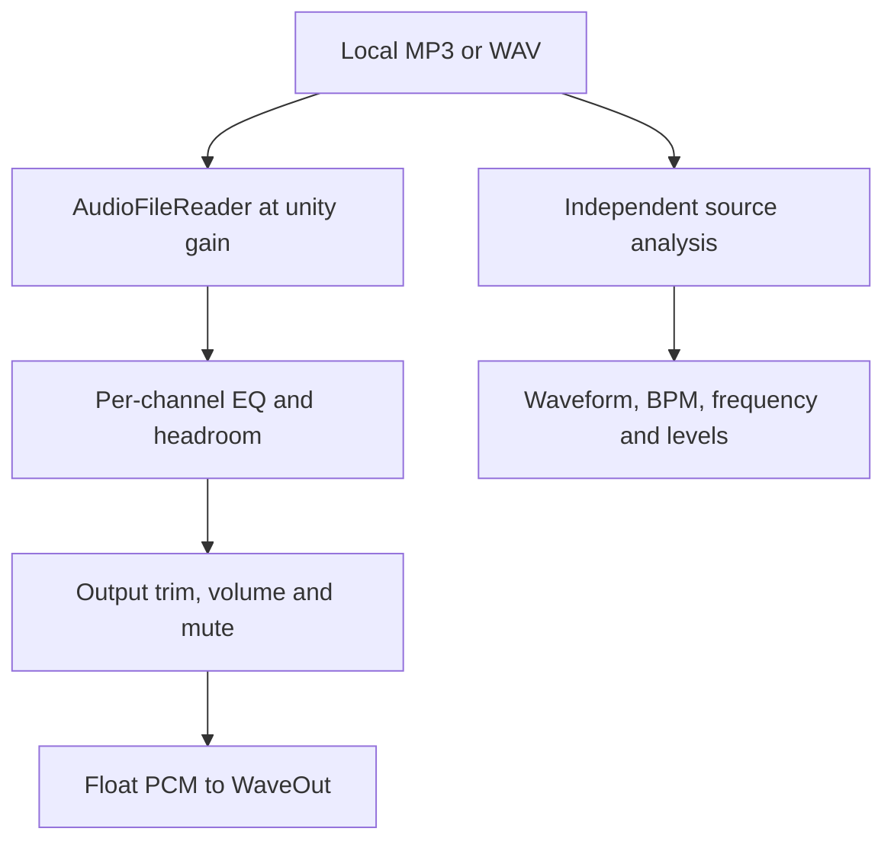

# MusicPlayer

MusicPlayer is a Windows desktop application for playing local MP3 and WAV files. It combines a searchable, folder-based music library with an interactive waveform, playback-synchronized signal analysis, automatic tempo estimation, and switchable graphic and parametric equalizers.

## Requirements and installation

Use a Windows desktop with the .NET 10 SDK and Git available in PowerShell. The application and test project target `net10.0-windows`. From PowerShell:

```powershell
git clone https://github.com/Jn527fd/MusicPlayer.git
Set-Location MusicPlayer
dotnet restore MusicPlayer.csproj
dotnet build MusicPlayer.csproj --no-restore
dotnet run --project MusicPlayer.csproj --no-build
```

In MusicPlayer, choose **File → Open Folder** to browse a music folder. Select a track to load it, then press **Play** or double-click the track. **File → Open File** loads the file's containing folder and selects the chosen track.

## Features

### Playback

- Play or pause local MP3 and WAV files. Seek with the timeline or by clicking a position on the waveform. The timeline shows elapsed time and track duration.
- Previous, Next, and automatic advancement use the visible track list, including active search results. With shuffle off, manual navigation wraps around and automatic playback stops after the last visible track.
- Shuffle picks a random visible track and excludes the current track when at least two tracks are visible. Repeat replays the current track at the end and takes precedence over automatic advancement.
- Set volume with the slider or toggle mute while retaining the selected volume.

### Music library

- Browse supported files directly inside one folder, sorted alphabetically by filename. Search matches filename substrings without regard to case and trims surrounding whitespace. The song count shows the folder total.
- View the filename, duration, and BPM in the track list. Now Playing also shows format, sample rate, channel layout, and bitrate when available.
- Assign artwork to an individual track from a local PNG, JPEG, or BMP file or a direct HTTPS image URL. Imports are limited to 5 MB and saved as app-local PNGs associated with the track's path.
- Use **File → Set Default Folder** to reopen a folder at startup. **Clear Default Folder** removes the saved startup choice. The default folder, artwork, and waveform and tempo caches are stored under `%LOCALAPPDATA%\MusicPlayer`.

### Audio analysis

- **Waveform** summarizes the full track into 400 peak bins and redraws a moving playhead as playback or seeking changes position. The waveform is cached on disk for reuse.
- **Frequency and levels** use 4,096-point FFTs with Hann windowing for relative bass, midrange, and treble energy, alongside time-domain RMS and sample peak in dBFS. The three bands cover 20–250 Hz, 250 Hz–4 kHz, and 4–16 kHz, with upper bounds excluded. The app selects the analysis frame for the current playback position. Values below full scale are negative in dBFS.
- **Tempo** prefers embedded BPM metadata. When a track without a BPM tag is opened, the detector uses spectral flux and normalized autocorrelation to estimate a tempo in the 60–200 BPM range. It requires at least eight seconds of onset data and sufficient rhythmic repetition. Now Playing identifies estimated BPM and shows a rhythm-strength score. BPM stays unavailable if the detector cannot make an estimate. Successful estimates are cached using the path, file size, modification time, and detector version.
- Analysis runs in the background. Changing tracks cancels work for the previous track.

### Audio equalizer

Open **Sound → Equalizer** while playing or before opening a track. **Graphic EQ** is the startup mode. Its ten sliders cover 31.25 Hz to 16 kHz at ±12 dB. Choose **Flat**, **Bass Boost**, **Vocal**, or **V-Shape**. Manual slider edits select **Custom**. **Reset** clears the graphic bands, output trim and overload warning.

Choose **Parametric EQ** and **Add band**. Drag a point horizontally for frequency and vertically for gain, or select a band and type its exact values. A circle represents a bell. Left- and right-facing triangles represent low and high shelves. The ring and band number identify the selection. **Enabled** toggles one band. **Remove** frees its slot. Switching modes or closing the editor keeps both configurations for the session.

- **Range.** The editor accepts 0–16 ordered bands. Each supports ±24 dB. Frequency runs from the greater of 5 Hz and 0.001% of the decoded sample rate through 49.5% of that rate. Bell Q runs from 0.25 to 16. Higher Q narrows the bell. Shelf Q runs from 0.25 to √0.5 and controls transition steepness. Changing a bell to a shelf caps its Q and displays a message when necessary.
- **Keyboard.** Tab and Shift+Tab move between controls. Choose a band with the selector, use Space for checkboxes, and press Enter or leave a numeric field to apply it. Escape restores the accepted value or cancels a drag. Invalid input restores the last accepted setting and displays the reason.
- **Graph.** The solid line shows the filter target. Choose the dashed **With headroom**, **Final output**, or **Selected band** overlay for comparison. The axes show logarithmic frequency and gain in dB. Shelf markers show the specified shelf gain at the transition frequency, where the individual curve is halfway to that gain in dB. Before opening a track, the graph uses a labeled 48 kHz preview. A lower-rate track temporarily omits bands outside its range.
- **Gain staging.** Boosts automatically reserve headroom for the combined response. **Bypass EQ** temporarily flattens the filters and removes that compensation. Output trim (−24 to 0 dB), volume and mute still apply. Muted or zero-volume final output displays **Output silent**. During the approximately 20 ms transition the graph shows the requested steady-state target. Device buffering adds further audible latency.

A transient can still exceed full scale. **Output over 0 dBFS · Clear** appears when a sample sent to the device exceeds ±1. Lower the trim, clear the warning and replay the passage to check it. The player uses static gain and preserves the floating-point waveform through this stage. The main window's RMS, peak and spectrum continue to describe the source file.

## Architecture

WPF starts the application through `App.xaml` and opens `MainWindow`. The window coordinates application behavior in its code-behind and delegates playback, signal analysis, library discovery, and navigation to the classes below.

| Component | Responsibility |
| --- | --- |
| [MainWindow](MainWindow.xaml.cs) | Handles track selection, playback controls, default-folder settings, artwork import, and visualization updates. Starts and cancels background analysis and uses a dispatcher timer to update the timeline and meters. |
| [SongFile](SongFile.cs) | Stores the file path, display metadata, artwork, and tempo estimate. Notifies WPF bindings when artwork or tempo information changes. |
| [AudioPlaybackService](Services/AudioPlaybackService.cs) | Owns the decoder, EQ provider, and output device. Exposes transport, position, duration, volume, and EQ controls and raises events for media open, end, and failure. |
| [EqualizerSampleProvider](Services/EqualizerSampleProvider.cs) | Implements NAudio's `ISampleProvider` to apply per-channel filters and headroom attenuation to decoded samples. |
| [GraphicEqualizerDesign](Services/GraphicEqualizerDesign.cs) | Calculates sample-rate-specific peaking coefficients and a bound on combined boost. The render thread owns the filter delay lines. |
| [AudioAnalysisService](Services/AudioAnalysisService.cs) | Reads metadata with TagLibSharp and decodes source audio independently for waveform, frequency, level, and tempo analysis. Manages the waveform and tempo caches. |
| [MusicLibraryLogic](Services/MusicLibraryLogic.cs) and [PlaybackQueue](Services/PlaybackQueue.cs) | Implement folder discovery, filename matching, and visible-list navigation independently of WPF controls and audio hardware. |
| [EqualizerWindow](EqualizerWindow.xaml.cs) | Hosts both EQ modes, the response graph and keyboard-accessible band editing against the shared playback service. |



`AudioFileReader` uses Windows Media Foundation for MP3. For WAV it opens a `WaveFileReader` and uses an ACM conversion for supported compressed WAV codecs. The DSP receives interleaved 32-bit IEEE float PCM at the decoder's sample rate and channel count. Tests verify 8-, 16-, 24- and 32-bit integer WAV and 32-bit float WAV. Each non-flat filter uses double-precision coefficients and state. At unity output level, settled flat EQ and bypass pass finite float samples exactly.

`ToWaveProvider()` exposes the float samples as bytes for event-driven WinMM `WaveOut` on the default Windows output. NAudio 3.3.0 defaults to two 100 ms buffers. MusicPlayer requests the decoder format without an application resampler or channel mixer. Device acceptance, Windows mixing and the physical endpoint determine the final output. Seeking resets filter history at the next decoded block. Audio already queued at the device can still be heard.

## Technologies

| Area | Frameworks and tools |
| --- | --- |
| Application | C#, .NET 10, WPF, and XAML |
| Runtime packages | NAudio 3.3.0 for decoding, playback, and DSP. TagLibSharp 2.3.0 for embedded BPM and technical metadata. |
| Testing | Microsoft.NET.Test.Sdk 17.14.1, xUnit 2.9.3, and the xUnit Visual Studio runner 3.1.4 |
| Reporting and automation | Coverlet collector 6.0.4, ReportGenerator as a global .NET tool for HTML reports, and GitHub Actions |

## Automated testing

Run the Release suite from the repository root on Windows with the .NET 10 SDK. Filter by xUnit class name to run one group.

```powershell
$project = 'tests/MusicPlayer.Tests/MusicPlayer.Tests.csproj'
dotnet test $project -c Release
dotnet test $project -c Release --filter FullyQualifiedName~PlaybackLifecycleTests
dotnet test $project -c Release --filter FullyQualifiedName~WindowIntegrationTests
```

The tests use deterministic WAVs, in-memory sample providers, temporary music folders and private cache directories. Playback lifecycle tests use the real decoder, equalizer and an in-memory NAudio output device. WPF tests instantiate the XAML windows on STA dispatcher threads and await analysis completion. The suite runs without speakers, a visible window, network access during tests, or a personal music folder.

## Code coverage

```powershell
.\launch_coverage_report.ps1
.\launch_coverage_report.ps1 -NoOpen
```

The launcher collects Release coverage into a fresh directory under `TestResults/local/`, keeps the TRX and Cobertura XML, generates `coverage-report/index.html` and opens it in the default browser. Use `-NoOpen` on a headless runner. ReportGenerator must be on PATH or installable as a global .NET tool. Initial dependency and tool installation requires access to a package source. Both results directories are ignored by Git.

The Phase 2B engineering report records baseline and final Release coverage, response accuracy checks, WPF interaction tests, timing measurements and the manual playback checklist. [Interactive EQ report](PARAMETRIC_EQ_UI_REPORT.md) · [Parametric DSP report](PARAMETRIC_EQ_REPORT.md) · [Audio engine report](AUDIO_ENGINE_REPORT.md) · [Earlier coverage audit](tests/COVERAGE.md)

## Continuous integration

The Windows workflow builds the application and runs the full Release xUnit suite with the same collector settings as the local launcher. CI requires **at least 80% line coverage and 75% branch coverage**. The gate uses ReportGenerator 5.6.1's integer covered and total counts from `Summary.json`. The HTML report displays rounded percentages. A failed test, missing coverage report, or either fraction falling below its minimum fails the job. The `musicplayer-test-results` artifact retains available TRX, Cobertura and gate summary files for 14 days, including on failure. Both minimums are configurable in the [workflow](.github/workflows/tests.yaml).

To apply the CI gate locally after running the launcher, use PowerShell from the repository root with ReportGenerator on PATH.

```powershell
$run = Get-ChildItem TestResults/local -Directory | Sort-Object LastWriteTime -Descending | Select-Object -First 1
.\tests\Measure-Coverage.ps1 -ResultsDirectory $run.FullName -MinimumLinePercent 80 -MinimumBranchPercent 75
```

## Project structure

```text
MusicPlayer/
├── .github/workflows/tests.yaml
├── App.xaml
├── App.xaml.cs
├── AssemblyInfo.cs
├── MainWindow.xaml
├── MainWindow.xaml.cs
├── EqualizerWindow.xaml
├── EqualizerWindow.xaml.cs
├── SongFile.cs
├── Services/
│   ├── AudioAnalysisService.cs
│   ├── AudioPlaybackService.cs
│   ├── EqualizerSampleProvider.cs
│   ├── MusicLibraryLogic.cs
│   └── PlaybackQueue.cs
├── tests/MusicPlayer.Tests/
│   ├── MusicPlayer.Tests.csproj
│   ├── AudioAnalysisTests.cs
│   ├── AudioPlaybackServiceTests.cs
│   ├── EqualizerTests.cs
│   ├── MusicLibraryTests.cs
│   ├── PlaybackQueueTests.cs
│   ├── TempoDetectionTests.cs
│   ├── TestAudioFactoryTests.cs
│   ├── WaveformTests.cs
│   ├── TemporaryWavFile.cs
│   └── TestAudioFactory.cs
├── .gitignore
├── MusicPlayer.csproj
├── launch_coverage_report.ps1
├── README.md
└── ROADMAP.md
```

## Limitations

- MusicPlayer is a Windows WPF application. The library supports local MP3 and WAV files from one folder at a time, with nonrecursive scanning and filename-based search.
- Frequency and level displays measure source audio. They are independent of volume, mute, and EQ settings.
- BPM is a heuristic estimate and can resolve to a half-time or double-time interpretation. Short tracks or weakly repeating signals may yield no estimate.
- The app persists the startup folder, custom artwork, and analysis caches. Playback sessions, EQ settings across restarts, and user-defined presets are future work.

## Development roadmap

Planned work includes persistent playback sessions, saved EQ presets and response visualization, custom playlists, Windows media controls, post-EQ analysis, and a SQLite-backed library. Longer-term work includes gapless playback, crossfade, smart shuffle, and audio-similarity recommendations. See the [Development Roadmap](ROADMAP.md).
